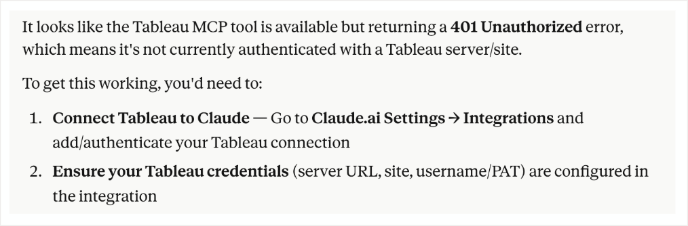
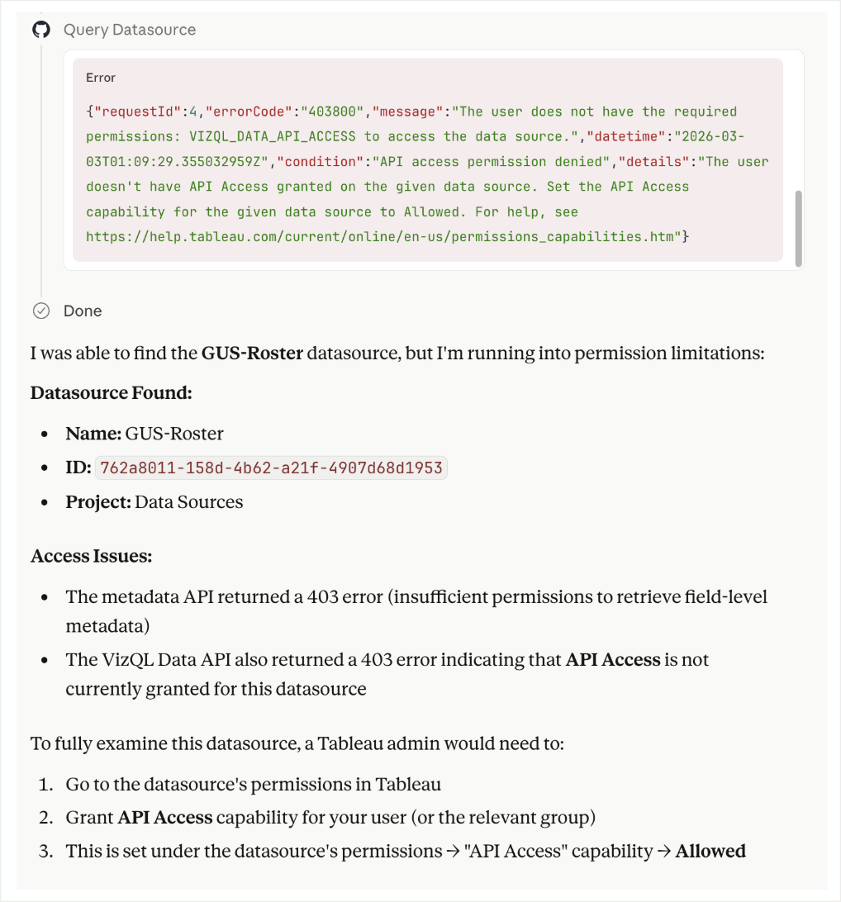

# Getting Started

This guide walks you through getting started with Tableau MCP. The easiest way for Cloud users to get started is to use the [remote hosted Tableau MCP server](hosted-tableau-mcp). To self-host Tableau MCP or run it locally, follow the guide below.

## Run with npx

The quickest way to run Tableau MCP locally. Requires [Node.js](https://nodejs.org/en/download) 22.7.5 or later — no cloning or building needed. Configure your AI tool (MCP client) with:

```json
{
  "mcpServers": {
    "tableau": {
      "command": "npx",
      "args": ["-y", "@tableau/mcp-server@latest"],
      "env": {
        "SERVER": "https://my-tableau-server.com",
        "SITE_NAME": "my_site",
        "AUTH": "pat",
        "PAT_NAME": "my_pat",
        "PAT_VALUE": "pat_value"
      }
    }
  }
}
```

`npx` will automatically download and run the latest published version from [npm](https://www.npmjs.com/package/@tableau/mcp-server).

## Build from source

Building from source is appropriate for those working on or contributing to the project, or for
anyone who wants to use the latest changes in between official releases. Developers need to
have Git and Node installed.

:::tip[Author in Tableau Studio using your locally built Tableau MCP]
To get started with using the MCP for authoring in Tableau Studio (Tableau Desktop updated with AI-enabled Tableau Agent), see [Use Tableau Studio Headless](ext://studio/use-tableau-studio-headless.html).
:::

### Work with the source code

1. Clone the repository.
2. Install [Node.js](https://nodejs.org/en/download).
3. `npm install`
4. `npm run build`

To keep up with repo changes:

1. Pull latest changes: `git pull`
2. `npm install`
3. `npm run build`
4. Relaunch your AI tool or 'refresh' the MCP tools.

### Run with Node

After building from source, configure your AI tool (MCP client) to use the MCP server with a snippet
like this:

```json
    {
  "mcpServers": {
    "tableau": {
      "command": "node",
      "args": ["full/path/to/build/index.js"],
      "env": {
        "SERVER": "https://my-tableau-server.com",
        "SITE_NAME": "my_site",
        "AUTH": "pat",
        "PAT_NAME": "my_pat",
        "PAT_VALUE": "pat_value"
      }
    }
  }
}
```

The project includes a template file `config.stdio.json` you can use as an example.

### Run with Docker

To use the Docker version of Tableau MCP, make sure that Docker is running, then build the image
from source:

```bash
$ npm run build:docker
$ docker images
REPOSITORY    TAG       IMAGE ID       CREATED        SIZE
tableau-mcp   latest    c721228b6dd3   15 hours ago   260MB
```

Next, configure your AI tool (MCP client) to use the MCP server with a snippet like this:

```json
{
  "mcpServers": {
    "tableau": {
      "command": "docker",
      "args": ["run", "-i", "--rm", "--env-file", "env.list", "tableau-mcp"]
    }
  }
}
```

The project includes a template file `config.docker.json` you can use as an example.

Remember to build the Docker image again whenever you pull the latest repo changes. Also you'll need
to relaunch your AI tool so it starts using the updated image.

### Run with Heroku

See [Deploy to Heroku](../extras/deploy-heroku.md) for new experimental Heroku support.

## Troubleshoot common issues

Here are some common issues that might come up – and how to solve them. The examples and screenshots
are from Claude Desktop but can apply similarly with any AI tools.

### 401 Unauthorized

When the AI client is using tools through Tableau MCP, it might fail and report a "401 Unauthorized"
error.



Solutions:

- Verify that the server URL and site names are correct
- For PAT_NAME, ensure you are providing the **name** of the PAT, not your username or email address
- Generate a new personal access token (PATs can
  [expire after 15 days if not used](https://help.tableau.com/current/server/en-us/security_personal_access_tokens.htm#change-personal-access-tokens-expiry))

### 403 Forbidden

For Tableau MCP to work, the user must have the "API access" permission enabled. In cases where the
user does not have that permission, a "403 Forbidden" error can occur.



Solution:

- If you are an administrator, grant API access to your user for that specific data source
- If not, request that the admin or project owner do that for you

### IP Filtering

On Tableau Cloud sites with IP filtering enabled, hosted Tableau MCP does not work until you update
the site allow list and point clients at a pod-level endpoint. In this situation, most AI clients
will report an error like `Access FORBIDDEN for this IP address`.

Solution:

To enable this combination, see the steps in [Tableau Cloud IP Filtering](../extras/ip-filtering.md).
