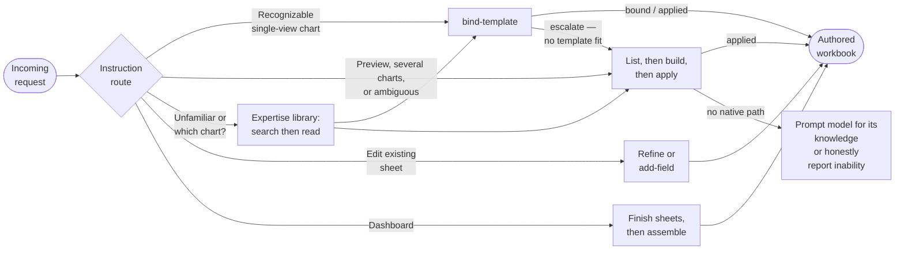

# Tableau Authoring

For authoring, the %coming_release% release Tableau MCP ships with more than a set of
**[Desktop Tools](./category/desktop-tools)**. It also carries expertise and
the authoring engine that helps an agent turn a plain request such as *"show me sales by region
over time"* into a correct, well-designed Tableau workbook.

The clean mental model is: **chart templates** provide reusable Tableau structure, **expertise**
guides analytical decisions, and **guardrails** prevent unsafe or unsupported changes.

The engine tries a known path first. If that is not enough, it prompts the model with
shipped expertise. If that still has no matching path, it asks the model to use its own
expertise and do what it can — not to invent an unsupported write.

:::danger[In progress]
Implementation of some aspects of the final expertise design is still in progress. Information
on this page may change for GA release.

Customizing the shipped expertise and skills and adding your own skills in your local fork of the
MCP will be supported in the %coming_release% release.
:::

## Overview of Tableau Authoring Response Process

### Try the chart template binder first (bind and apply)

The engine is **deterministic-first**. It maps a request to a known tool sequence before asking
a model to invent a decision path, and it moves on to involving the model rather than guessing when no native route covers the ask. That mapping to bind a prompt to a native route lives in the **instruction route table** the desktop server gives the agent — a typed list of triggers, tool sequences, and stop conditions.

| Ask | First path |
| --- | --- |
| Recognizable single-view chart | [`bind-template`](../desktop-tools/binder/bind-template.md). One call can bind and apply. |
| Calculated metric, no chart named (margin %, ratio, growth) | Create the calculation first ([`author-calc`](../desktop-tools/data-source/author-calc.md)), then follow the chart path above. [`bind-template`](../desktop-tools/binder/bind-template.md) can also author those fields in the same call via `calcs`. |
| Unfamiliar, calculation-heavy, or "which chart?" | Search the expertise library ([Expertise tools](../desktop-tools/expertise/search-expertise.md)) *before* building |
| Dashboard | Finish each worksheet, then assemble with [`run-dashboard-batch`](../desktop-tools/dashboard/run-dashboard-batch.md). Pass `existingWorksheetNames`/`kpiWorksheetNames` for sheets that are already live, or `artifactIds` for staged built artifacts |
| Change to an existing sheet | Edit in place: [`refine-worksheet`](../desktop-tools/worksheet/refine-worksheet.md) (top-N / sort) or [`add-field`](../desktop-tools/fields/add-field.md). New sheets only if asked |
| Number or data question against an existing sheet | Read that worksheet's summary rows ([`get-summary-data`](../desktop-tools/data-source/get-summary-data.md)). This is not a general datasource-query tool, and the row order it returns does not prove the chart's visual order |

For an unfamiliar or non-trivial authoring ask, the agent runs
[`search-expertise`](../desktop-tools/expertise/search-expertise.md) first, then
[`read-expertise-resource`](../desktop-tools/expertise/read-expertise-resource.md) on the
top hit, and only then proceeds.

### Fall back to prompt the model with expertise (list, then build, then apply)

This path is three separate tool calls, not one bind-and-apply. Use it when a single
[`bind-template`](../desktop-tools/binder/bind-template.md) write is the wrong first
move. The three steps are:

1. **List** — inspect what you can bind, without writing. Call
   [`list-templates`](../desktop-tools/binder/list-templates.md) to see which chart
   templates are available, and
   [`list-available-fields`](../desktop-tools/fields/list-available-fields.md) to see
   which fields in the open workbook can fill those templates.
2. **Build** — turn a chosen template and those fields into a worksheet **artifact**. Call
   [`build-worksheets-from-templates`](../desktop-tools/template/build-worksheets-from-templates.md).
   The artifact lives in the MCP server; it is not yet a sheet in the workbook. Several
   artifacts can coexist until you apply them.
3. **Apply** — write an artifact into the open workbook. Call
   [`apply-worksheet`](../desktop-tools/worksheet/apply-worksheet.md) only when the user
   is ready for a change. Applies are sequential. An artifact is never replayed against a
   %product_name% instance that has restarted.

Take this path in these situations: 
- The ask is **ambiguous** — more than one chart could be right, so list templates and fields
  before choosing.
- The user wants a **preview** and nothing should be written yet. Binding with `auto_apply`
  would write; this path can build the artifact and **stop before apply**.
- The work is **several charts**, not one sheet, so a single bind-and-apply is the wrong grain.
- The binder returned **`escalate`** — no fast-path template fits, so leave the binder
  rather than retry it.

## Details

### Binder answers

[`bind-template`](../desktop-tools/binder/bind-template.md) is the first path when the
request is a recognizable single-view chart. Matching the ask to a template and filling its
slots from the open workbook is **deterministic**. The server does not call a model to invent
that mapping. A model is still in the loop as the agent: it chooses to call the tool, and on a
`propose` result it picks among the candidates the server returned.

The binder returns one of four answers, and each one has a next step:

| `status` | What it means | Next step |
| --- | --- | --- |
| `bound` | Ready — every required slot is filled | You can write it. Done when `auto_apply` succeeded. Otherwise apply the returned arguments (or inspect them without writing). |
| `propose` | Not sure — no deterministic match | **One** follow-up allowed: send the chosen `proposal` back. It is checked for confidence and correctness before the sheet is written. |
| `escalate` | No fit — no fast-path template covers the ask | Leave the binder and go to the next tier: [list, then build, then apply](#fall-back-to-prompt-the-model-with-expertise-list-then-build-then-apply), or lower-level authoring. Do not guess. |
| `blocked` | Already tried, still failing | Do not retry the same ask. Change the proposal from the reported blockers, or take the fallback path. |

### Fast path for a single chart

One binder call can bind and apply (`auto_apply: true`). Skip the auto-save flag if you just
want to see what it would do: omit `auto_apply` to get the bound arguments without writing.
That inspection stays on the binder. It is not
[list, then build, then apply](#fall-back-to-prompt-the-model-with-expertise-list-then-build-then-apply), which is for asks that should
not bind-and-apply in one step.

### When no template fits

Drop to the smaller tools — [`author-calc`](../desktop-tools/data-source/author-calc.md),
[`author-parameter`](../desktop-tools/data-source/author-parameter.md),
[`author-set`](../desktop-tools/data-source/author-set.md),
[`author-action`](../desktop-tools/data-source/author-action.md),
[`format-worksheets`](../desktop-tools/worksheet/format-worksheets.md) — then the template
path. Small in-place edits (top-N, sort) have a narrow
[`refine-worksheet`](../desktop-tools/worksheet/refine-worksheet.md) fast lane;
anything outside that lane should be **refused, not attempted**. Asks the binder has no fast
path for (sets, drilldown) go to that same lower-level authoring. If no native or sanctioned
cached-file route covers the ask, prompt the model with its own expertise
and do what the remaining tools can do. Say so plainly only when that tier still cannot
complete the ask.

### Not every write is checked afterward

Whether a write is checked afterward depends on the tool, not the size or complexity of the change. Some tools read the changed workbook structure back from Studio and check that the expected changes are present. Common paths have a guardrail the validates that the promise of the MCP, such as applying a worksheet, actually happened. More complex scenarios may not have this benefit.

The single-worksheet paths and the smaller tools re-read what they wrote to confirm it stuck.
Worksheet apply paths that advertise host verification —
[`apply-worksheet`](../desktop-tools/worksheet/apply-worksheet.md),
[`refine-worksheet`](../desktop-tools/worksheet/refine-worksheet.md) — re-read the
affected sheet and treat a failed readback as a failure, not a success.
The smaller
authoring tools (`author-calc`, `author-parameter`, `author-set`, `author-action`) also verify
the write on readback.

`bind-template` with `auto_apply: true` checks the applied worksheet’s structure. `run-dashboard-batch` also checks the dashboard structure after assembly, even though it can involve multiple sheets. The raw `apply-workbook`, `apply-dashboard`, and `apply-storyboard` tools do not perform this structural check; their receipts identify that limitation.

After each change, check the tool’s verification result. If the tool does not verify its write, read the affected workbook content back from Desktop and compare it with the intended change before reporting success. Clearly state anything that remains unverified.

### Only errors block a write

A validation pass over the generated XML must be clean before it is applied, and the binder
enforces slot coverage, field/role/kind checks, and derivation legality. **Only real errors
block a write.** Warnings and info messages do not.

### Expertise library

The library is found by **tags** and short "when to use" notes, not by searching the full
text. So the tags matter a lot. The agent is instructed to read the matching module before
authoring.

It is split three ways — this is the split forks depend on:

| Domain | What it holds | Think of it as | Customization (planned) |
| --- | --- | --- | --- |
| `tactics/` | How Tableau works. Objective, factual mechanics: the XML you generate, node/attribute rules, confirmed-working patterns, version-stamped behavior. | Tableau **mechanics** (expertise) | Protected. You cannot override this. |
| `strategy/` | How to make a good chart. Chart choice, design, storytelling, when to push back, how to disambiguate a request, what "best" looks like. Would still be true for another BI tool. | Analytical **judgment** (skills) | You can override. |
| `personalization/` | Your defaults and preferences. Suggested defaults, an org style guide, solution-routing choices. | **Preferences** (defaults) | You can override. |

These customization permissions are **planned** for the %coming_release% release. They are the
intended split — tactics stay core, strategy and personalization can be overridden — not a
guarantee that the current build enforces them. See also
[Customize the authoring expertise](ext://studio/customize-tableau-agent.html).

### Local templates win (overriding shipped templates)

_coming in %coming_release% release_

If you have a template with the same name in your local %product_name% repository, that one
wins over the bundled one. [`list-templates`](../desktop-tools/binder/list-templates.md)
shows broken templates on purpose, with the reason, so you can see why they were skipped.
[`build-worksheets-from-templates`](../desktop-tools/template/build-worksheets-from-templates.md)
will not use a failing template, because that would produce a broken sheet.

### Stable handoffs

When one tool (or skill) finishes work another is meant to continue, the handoff is
schema-versioned — and **declining a handoff is a fine ending**. Do not invent a next step the
schema does not name. 

## How it's built

Chart templates, expertise, and guardrails are carried by distinct, individually addressable
assets.

### Chart templates and MCP actions

Where the corpus informs judgment, these assets are consumed directly by the authoring tools.

| Asset | What it is | Surfaced through |
| --- | --- | --- |
| **Chart templates** | Reusable worksheet structure. Each template's chart *family*, intent keywords, and field *slots* are available to the tools at bind time. | [`list-templates`](../desktop-tools/binder/list-templates.md), [`bind-template`](../desktop-tools/binder/bind-template.md), [`build-worksheets-from-templates`](../desktop-tools/template/build-worksheets-from-templates.md) |
| **Dashboard guide** | Guidance on the dashboard zone tree, coordinate system, and layout patterns. | MCP resource `tableau://docs/dashboard-xml-guide` |

Chart templates are grouped into a small **family taxonomy** — `time-series`, `ranking`,
`part-to-whole`, `correlation`, `distribution`, `deviation`, `magnitude`, `spatial`, `kpi`, and
`specialized`. Family is derived from the template's name (for example
`change-over-time__line__default-time-series-trend.tbm` is `time-series`). Browse the catalog
with [`list-templates`](../desktop-tools/binder/list-templates.md) when you need to pick
among templates rather than bind from the ask.

The catalog the tools search is the in-package library plus, when a local %product_name%
repository is available, additional templates and saved bookmarks from that repository. A
same-named local entry shadows the bundled one.

Chart templates are saved Tableau bookmarks (`.tbm` files). Which fields a chart needs — and
which of those are required — is inferred from the template when it loads.

### Core expertise

The heart of the expertise is a library of curated Markdown modules, each surfaced to the agent
as a readable resource and searchable by intent through the
[expertise tools](../desktop-tools/expertise/search-expertise.md). Rather than one flat
pile, it is organized into the three domains above by *how the content behaves*.

A representative strategy module is **chart selection**, which maps a question's category
(Comparison, Change over Time, Part-to-Whole, Distribution, Relationship, Ranking, Geographic,
…) to appropriate chart types — the same judgment the template catalog encodes in each
template's family and name.

The corpus is **searched by curated metadata** (tags, "relevant prompts", "when to use", title)
rather than raw body text, so a request retrieves the *right* module.

### Guardrails

A registry of validation rules turns generated XML into a list of issues before it is applied.
Errors block the apply and come with fix guidance; warnings and info do not. Rules span
structure (well-formed XML, unresolved template tokens), encodings and marks, calculations
(aggregation and dependency checks), filters and sort (malformed top-N, crash-prone sorts),
dashboards (zone and action integrity), and authoring boundaries. These guardrails are what let
the engine attempt an automated build while still failing closed on anything incorrect.

After a write, only the [paths listed above](#not-every-write-is-checked-afterward) that
advertise host verification (or an equivalent readback check) treat a failed re-read as a
failure.

### On disk

Template and corpus layout, for local forks and reviewers.

| Asset | On disk |
| --- | --- |
| Chart template bookmarks | `src/desktop/data/templates/*.tbm` |
| Curated examples + diff corpus | `src/desktop/data/examples/` and `src/desktop/data/corpus.json` |
| Workbook schema | `src/desktop/data/twb_2026.2.0.xsd` |
| Dashboard guide | `resources/desktop/dashboard-xml-guide.md` |
| Validation rule registry | `src/desktop/validation/registry.ts`; individual rules under `src/desktop/validation/rules/` |

## Known limits

These are confirmed gaps in the authoring tool surface. They are why some asks leave
bind-and-apply, or list-then-build-then-apply, and fall through to the model's own expertise
— or stop with an honest "cannot do that." 

**Dashboard visual checks**  There is no visual verification of dashboard formatting. | _What skills do:_ Deliver dashboard work as precise manual instructions with menu paths. Do not claim to assemble.

**Modal dialogs are unavoidable**  %product_name% shows dialogs on routine successful tool
calls. They cannot be suppressed and do not indicate failure. | _What skills do:_ Warn the
user up front that dialogs will need to be dismissed. Do not treat them as errors.

**Whole-document validation on single-sheet writes**  A build fails if any pre-existing issue
exists anywhere in the workbook, even when the new sheet is fine. The error list can be cached
and misleading. | _What skills do:_ Before concluding a workbook is broken, test the same
operation against an unrelated data source.

**[`get-xml`](../desktop-tools/workbook/get-xml.md) fails on dashboard-bound sheets**  Returns 500 / operation-failed on
sheets placed on a dashboard with real data. | _What skills do:_ Do not call
[`get-xml`](../desktop-tools/workbook/get-xml.md) with kind worksheet on
dashboard-bound sheets. Use [`list-available-fields`](../desktop-tools/fields/list-available-fields.md)
formula text plus dashboard XML hints as the fallback (Logic Explainer HC#7).

**Worksheet applies ([`apply-worksheet`](../desktop-tools/worksheet/apply-worksheet.md), `bind-template` with `auto_apply`) can corrupt parameter-referencing calcs**  Formula text reads back
unchanged while live behavior is broken. Readback cannot detect this. | _What skills do:_
Hard-stop on any worksheet-shelf-mutating tool call when the data source contains
parameter-referencing calcs. Calc Translator and Data Scribe already enforce this.

**`author-calc` hangs are non-deterministic**  Can exceed a two-hang ceiling within a single
session. | _What skills do:_ After the second hang, stop retrying and prompt the user to
complete remaining calcs manually. Do not treat the ceiling as a soft target.

**Fresh parameters do not resolve in new calcs**  A parameter that
[`resolve-field`](../desktop-tools/fields/resolve-field.md) just confirmed can fail to
resolve by bare name in a subsequently-created calc. | _What skills do:_ Retry once after
asking the user to reselect / refresh the Data pane in %product_name%. If that fails, fall
back to manual calc creation.

**`author-parameter` Windows reopen bug**  New parameters aren't resolvable by bare name until
the workbook is closed and reopened. | _What skills do:_ On Windows, create parameters at the
top of the session or warn the user that a reopen may be required.

**CSV overwrite strips the UTF-8 BOM**  First write to a new path keeps the BOM. Overwriting
the same path silently removes it. | _What skills do:_ Write CSVs to a fresh filename (`_v2`,
`_v3`) instead of overwriting.

**Worksheet text mutation is not reliable**  Titles, captions, tooltips, and dashboard text can
be read but not rewritten by tool. | _What skills do:_ Stay read-only for text (Desktop
Spellcheck, i18n Scanner). Deliver findings, let the user apply them.

**Broken-field calcs cannot be placed on a shelf**  %product_name% UI blocks the drag. This is
product behavior, not an MCP bug. | _What skills do:_ For testing, use runtime-error calcs
(division by zero, DATEPARSE with bad input) instead of broken-field references.

**Missing lifecycle commands**  No `calc-delete`, `parameter-delete`, `set-delete`, or
`hierarchy-delete` tools exist. Delete worksheets, dashboards and stories with
[`delete-sheet`](../desktop-tools/workbook/delete-sheet.md). | _What skills do:_ Advise the user on
cleanup manually. Do not promise deletion.

