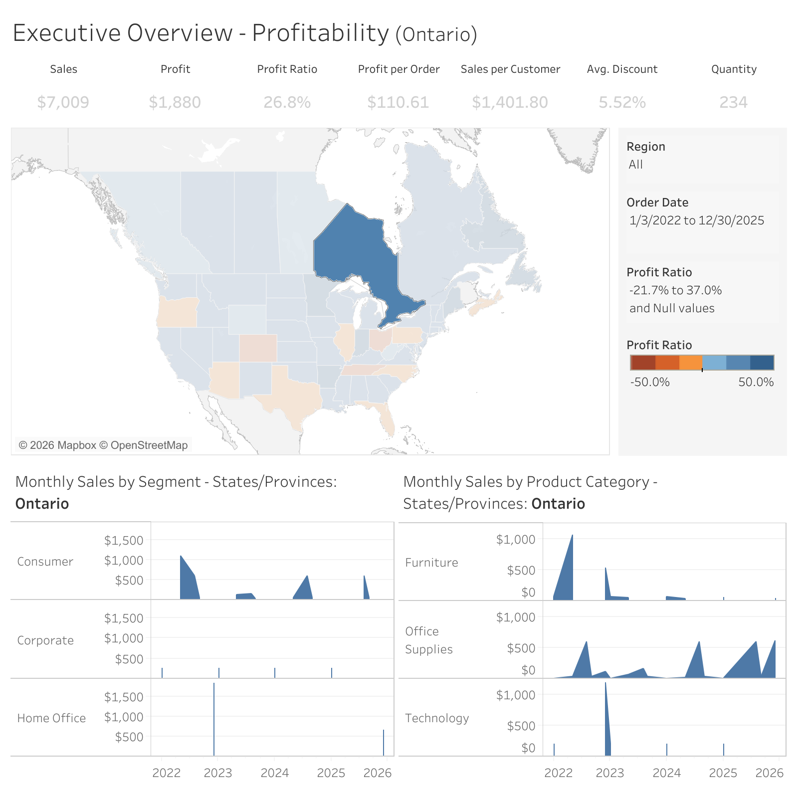

# Get Custom View Image

{/* availability */}
<span className="toolAvailability">Available June 2026 and later.</span>
{/* /availability */}

Retrieves an image for a **custom view** (a saved or personalized state of a published sheet,
including the user's filters). For a published view without a custom view, use
[Get View Image](get-view-image.md) with the view id.

## APIs called

This tool talks to the **Tableau REST API** (Tableau Cloud or Server): it renders the custom view
image, and — when [tool scoping](../../configuration/mcp-config/tool-scoping.md) is enabled —
resolves the custom view's underlying published view so the configured scope can be enforced before
the image is returned. The MCP-layer OAuth gate requires the union of the scopes cited per operation
below (`tableau:views:download` and `tableau:content:read`) plus `tableau:mcp_site_settings:read` to
read per-site MCP configuration overrides when MCP site settings are enabled.

- **Render the custom view image.** Returns the custom view rendered at high resolution in the
  requested `format`, applying any `width`, `height`, and `viewFilters`.
  - `GET /api/{version}/sites/{siteId}/customviews/{customViewId}/image` — render the custom view
    image. Issued against the Tableau REST API; requires the `tableau:views:download` OAuth scope.
    [Get Custom View Image](https://help.tableau.com/current/api/rest_api/en-us/REST/rest_api_ref_workbooks_and_views.htm#get_custom_view_image)
- **Resolve the underlying view for tool scoping** (only when
  [tool scoping](../../configuration/mcp-config/tool-scoping.md) is enabled). Looks up the custom
  view's underlying published view and checks it against the configured project / workbook / view /
  tag scope before rendering.
  - `GET /api/{version}/sites/{siteId}/customviews/{customViewId}` — resolve the underlying view id
    of the custom view. Issued against the Tableau REST API; requires the `tableau:content:read`
    OAuth scope.
    [Get Custom View](https://help.tableau.com/current/api/rest_api/en-us/REST/rest_api_ref_workbooks_and_views.htm#get_custom_view)
  - `GET /api/{version}/sites/{siteId}/views/{viewId}` — read the resolved view to enforce the
    configured scope. Issued against the Tableau REST API; requires the `tableau:content:read` OAuth
    scope.
    [Get View](https://help.tableau.com/current/api/rest_api/en-us/REST/rest_api_ref_workbooks_and_views.htm#get_view)

## Required arguments

### `customViewId`

The LUID of the custom view. This appears in the Tableau URL for a saved view (e.g. the
`<customViewId>` in `/views/WorkbookUrl/SheetUrl/<customViewId>/<customViewName>`), not the
published view id returned by List Views for the sheet alone.

## Optional arguments

### `width`

The width of the rendered image in pixels that, along with the value of `height` determine its
resolution and aspect ratio.

Example: `1600`

<hr />

### `height`

The height of the rendered image in pixels that, along with the value of `width`, determine its
resolution and aspect ratio.

Example: `1200`

<hr />

### `format`
The format of the image. Default: `PNG`

- **`PNG`** (default): Raster image format. Works with all Tableau Server versions.
- **`SVG`**: Vector graphics format. Scalable and smaller file size. **Requires Tableau Server
  2026.2.0+ (REST API v3.29+)**.

**Choosing a format:**

- Prefer `PNG` when the image will be **analyzed or interpreted** (e.g. answering questions about
  the data in the viz).
- Prefer `SVG` when the image will be **displayed to the user** (e.g. embedding or rendering the viz
  in a response).

Example: `SVG`

:::note[Format availability]
Requesting `SVG` when the connected Tableau Server is older than 2026.2.0 is refused: SVG format
requires Tableau Server 2026.2.0 or later. Current version: the message includes the connected
server's product version. If the image format feature is disabled on this Tableau Server, the tool
reports that the image format feature is disabled.
:::

<hr />

### `viewFilters`
Map of filter field names to values; sent as `vf_<fieldname>` query parameters per
[filter query views](https://help.tableau.com/current/api/rest_api/en-us/REST/rest_api_concepts_filtering_and_sorting.htm#Filter-query-views).

## Example result

- When `format` is `PNG`, the MCP result will contain the PNG image content (MCP result with
  `type=image` and `mimeType=image/png`).
- When `format` is `SVG`, the MCP result will contain both the SVG XML (`type=text`) and the SVG
  image content (`type=image` and `mimeType=image/svg+xml`)



## Related

- [`get-view-image`](get-view-image.md) — image of a published view by view id
- [`get-custom-view-data`](get-custom-view-data.md) — CSV data for a custom view
- [`list-custom-views`](list-custom-views.md) — find custom view LUIDs

{/* tool-details */}
## Response behavior

The tool returns one of two result shapes:

- **`MCP_S3_BUCKET` unset (default):** returns the rendered image inline, base64-encoded.
- **`MCP_S3_BUCKET` set:** returns a `resource_link` with a short-lived presigned URL to the
  rendered image in S3 (with `mimeType` matching `format`), instead of inlining the image data.

## Example result (S3 mode)

```json
{
  "type": "resource_link",
  "uri": "https://example-bucket.s3.amazonaws.com/...presigned...",
  "name": "view-image.png",
  "mimeType": "image/png",
  "description": "Rendered view image stored in S3. This is a short-lived presigned URL."
}
```
{/* /tool-details */}
