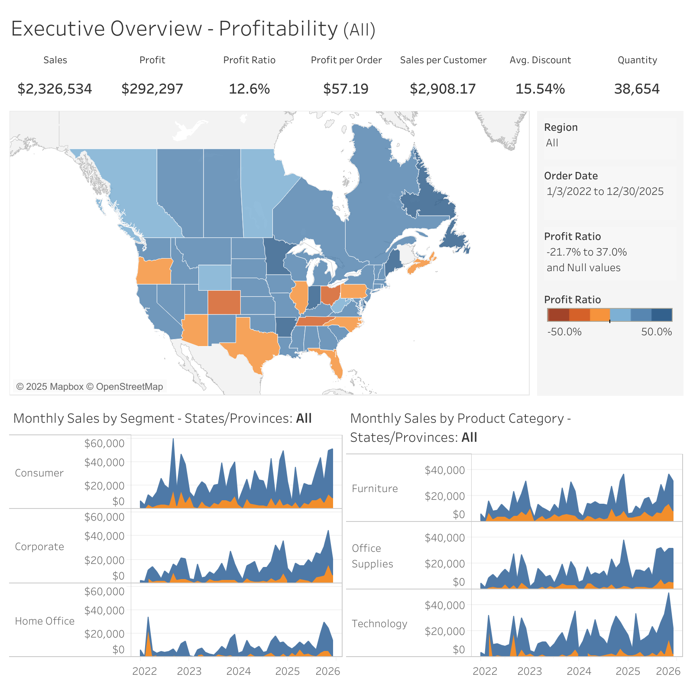

# Get View Image

{/* availability */}
<span className="toolAvailability">Available June 2026 and later.</span>
{/* /availability */}

Retrieves an image of the specified view in a Tableau workbook. Optional `width` and `height` in
pixels control the render size, and optional view filters narrow the data shown. For custom views,
use [`get-custom-view-image`](get-custom-view-image.md) instead.

## APIs called

The tool renders the requested view through the Tableau REST API (Tableau Cloud or Server). The
MCP-layer OAuth scope is `tableau:mcp:view:download`; across the calls below it needs the
`tableau:views:download`, `tableau:content:read`, and `tableau:mcp_site_settings:read` OAuth scopes.

- Render the specified view as an image at the requested size, format, and filters.
  - `GET /api/{version}/sites/{siteId}/views/{viewId}/image` — return the rendered image. Issued
    against the Tableau REST API; requires the `tableau:views:download` OAuth scope.
    [Query View Image](https://help.tableau.com/current/api/rest_api/en-us/REST/rest_api_ref_workbooks_and_views.htm#query_view_image)
- When [tool scoping](../../configuration/mcp-config/tool-scoping.md) (bounded context) is enabled,
  verify the requested view is within the allowed set before rendering.
  - `GET /api/{version}/sites/{siteId}/views/{viewId}` — fetch the view's workbook, project, and
    tags for the access check. Issued against the Tableau REST API; requires the
    `tableau:content:read` and `tableau:mcp_site_settings:read` OAuth scopes.
    [Get View](https://help.tableau.com/current/api/rest_api/en-us/REST/rest_api_ref_workbooks_and_views.htm#get_view)

## Required arguments

### `viewId`

The ID of the view, potentially retrieved by the [List Views](list-views.md) or
[Get Workbook](../workbooks/get-workbook.md) tool.

Example: `9460abfe-a6b2-49d1-b998-39e1ebcc55ce`

## Optional arguments

### `width`

The width of the rendered image in pixels that, along with the value of `height`, determines its
resolution and aspect ratio.

Example: `1600`

<hr />

### `height`

The height of the rendered image in pixels that, along with the value of `width`, determines its
resolution and aspect ratio.

Example: `1200`

<hr />

### `format`
The format of the image. Defaults to `PNG`.

- **`PNG`** (default): Raster image format. Works with all Tableau Server versions.
- **`SVG`**: Vector graphics format. Scalable and smaller file size. **Requires Tableau Server
  2026.2.0+ (REST API v3.29+)**.

Example: `SVG`

#### Choosing a format

- Prefer `PNG` when the image will be **analyzed or interpreted** (e.g. answering questions about
  the data in the viz).
- Prefer `SVG` when the image will be **displayed to the user** (e.g. embedding or rendering the viz
  in a response).

:::note[Version requirement]
Requesting `SVG` against a Tableau Server older than 2026.2.0 is rejected with a validation error:
SVG format requires Tableau Server 2026.2.0 or later. Current version: the message includes the
connected server's product version. If the image-format feature is disabled on the Tableau Server,
the tool reports that the feature is unavailable.
:::

<hr />

### `viewFilters`
Map of view filter field names to values. The `vf_` prefix for field names is optional and will be
added automatically when building the view filter query.

Example: `{ "year": "2017" }`

## Example result

- When `format` is `PNG`, the MCP result will contain the PNG image content (MCP result with
  `type=image` and `mimeType=image/png`).
- When `format` is `SVG`, the MCP result will contain both the SVG XML (`type=text`) and the SVG
  image content (`type=image` and `mimeType=image/svg+xml`).



## Related

- [`get-view-data`](get-view-data.md) — retrieve the specified view's underlying data as CSV
- [`get-custom-view-image`](get-custom-view-image.md) — render an image of a custom view
- [`list-views`](list-views.md) — find the `viewId` for a view on the site

{/* tool-details */}
## Response behavior

The tool returns one of two result shapes:

- **`MCP_S3_BUCKET` unset (default):** returns the rendered image inline, base64-encoded.
- **`MCP_S3_BUCKET` set:** returns a `resource_link` with a short-lived presigned URL to the
  rendered image in S3 (with `mimeType` matching `format`), instead of inlining the image data.

## Example result (S3 mode)

```json
{
  "type": "resource_link",
  "uri": "https://example-bucket.s3.amazonaws.com/...presigned...",
  "name": "view-image.png",
  "mimeType": "image/png",
  "description": "Rendered view image stored in S3. This is a short-lived presigned URL."
}
```
{/* /tool-details */}
